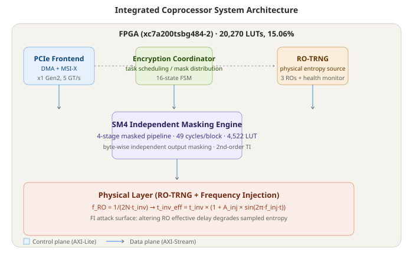
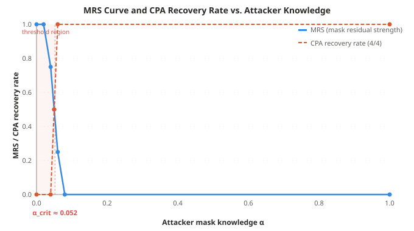

# Frequency Injection Attacks on SM4 Masking: From RO Entropy to CPA via Second-Order Countermeasures

**摘要**：掩码（Masking）是抵抗侧信道攻击的核心技术，其安全性高度依赖掩码的不可预测性。现有工作分别研究掩码密码学与TRNG（True Random Number Generator，真随机数发生器）鲁棒性，缺乏将两者关联的系统级分析。本文以国密SM4算法的FPGA（Field Programmable Gate Array，现场可编程门阵列）掩码实现为载体，量化了频率注入攻击从RO-TRNG（Ring Oscillator-based True Random Number Generator，基于环形振荡器的真随机数发生器）熵源退化到CPA密钥恢复的完整链路。本文构建了端到端仿真验证平台，包含RO门级模型、SP 800-22熵评估、掩码退化建模以及TVLA与CPA安全评估。主要发现包括：(1) 掩码残余强度随注入幅度呈阈值衰减，攻击者仅需约5%的掩码知识度即可使CPA从完全失败变为完全恢复，该阈值行为在测量噪声标准差不超过2.0的条件下保持稳定；(2) 在共享掩码输出再掩码引擎中识别了二阶泄漏通道，并提出逐字节独立输出掩码方案，以增加12个查找表的代价将二阶TVLA统计量从49.84降至1.12，CPA恢复率从6次全部恢复降至0次恢复，并通过形式化验证确认二阶门限实现安全性；(3) RO-TRNG熵源通过SP 800-90B最小熵估计与AIS-31（德国信息安全标准 AIS-31）全部6级功能类合规评估；(4) 一体化协处理器在xc7a200tsbg484-2 FPGA上实现，独立掩码引擎达到4,522个查找表、每分组49个时钟周期、每查找表57.8千比特每秒的吞吐效率，RO-TRNG通过SP 800-22全套15项统计测试。本文为理解掩码安全的条件依赖性提供了仿真量化证据，表明RO-TRNG鲁棒性是掩码安全的必要条件。

> **2026-11-01 更新**：F4（项目决策点） 决策后，逐字节独立输出掩码引擎（v4_indep 版本 / v5 版本）已提为板级默认 DUT（Device Under Test，被测器件），论文性能数据与板级网表口径一致；掩码种子改为每次 SM4 事务前置从 TRNG 真随机数模块（真随机熵源）取 64-bit（P0-6（项目阶段） 修复方案2），消除确定性掩码种子缺陷；全量回归 8/8 通过，Vivado 2026.1 综合 0 errors。

**关键词**：SM4；侧信道攻击；掩码；频率注入；RO-TRNG；二阶泄漏；FPGA；门限实现；min-entropy（最小熵）；AIS-31；形式化验证

**中图分类号**：TN918.4

---

## 1. 引言

SM4是中国商用密码算法标准（GM/T（中国商用密码标准） 0002-2012），广泛应用于无线局域网、移动通信、物联网等场景。掩码（Masking）是抵抗侧信道攻击最有效的技术之一，但其安全性存在一个根本前提：掩码必须是不可预测的。一旦掩码可预测（例如由于物理熵源被干扰），整个掩码方案的安全性将崩塌[1]。频率注入攻击（Frequency Injection Attack）是一种针对RO-TRNG的物理层攻击：攻击者向环形振荡器注入特定频率的干扰信号，使RO锁定在非理想振荡状态，从而降低输出熵[2]。现有文献分别从两个方向研究此问题——掩码密码学，该领域假设随机数给定和TRNG鲁棒性，该领域关注熵源健康，缺乏将两者关联的系统级分析。本文以国密SM4算法的FPGA掩码实现为载体，量化了频率注入攻击从RO-TRNG熵源退化到CPA密钥恢复的

### 1.1 研究背景与动机

频率注入攻击（Frequency Injection Attack）是一种针对RO-TRNG的物理层攻击：攻击者向环形振荡器注入特定频率的干扰信号，使RO锁定在非理想振荡状态，从而降低输出熵[2]。现有文献分别从两个方向研究此问题：

- **掩码密码学**：假设随机数完美给定，研究如何用最少的随机数消耗实现d阶抗性[3-7]。代表性工作包括Wei等的非平衡共享TI（2.0 kGE, 8 bit随机数）[3]、胡晓婷等的塔域二次分解+CoTG二阶TI（66 bit/轮）[7]。
- **TRNG鲁棒性**：研究RO在频率注入下的熵退化，使用SP 800-22统计测试评估[8-10]。

**然而，现有研究较少将两者结合**：如果RO熵源因频率注入而退化，掩码变得可预测，CPA攻击需要多少轨迹即可恢复密钥？这个问题的答案直接决定了掩码方案在物理攻击下的实际安全边界，但目前仅有定性讨论，缺乏定量建模。

### 1.2 本文贡献

针对上述差距，本文的主要贡献包括：

1. **频率注入、掩码退化与CPA的耦合建模**：构建了端到端仿真链路，量化RO频率注入对掩码SM4 CPA攻击效果的影响。提出alpha参数化攻击者掩码知识度，建立MRS（Mask Residual Strength，掩码残余强度）曲线——粗扫，alpha步长为0.1确定阈值在(0, 0.1)区间，细扫（alpha步长0.02）精确定位临界值α_crit≈0.05：当alpha从0增至0.1时，MRS从1.000骤降至0.000，CPA从0/4跃升至4/4完全恢复。该阈值行为表明掩码安全对熵源质量的极端敏感性。

2. **二阶泄漏通道定位与消除**：在共享掩码输出再掩码引擎中定位tau×tau二阶泄漏根因（4个S-box字节共享单一输出掩码mout8），提出逐字节独立输出掩码方案。实验表明：二阶TVLA从|t|=49.84降至1.12（低于4.5检测阈值），CPA恢复率从6/6降至0/6，代价仅+12 LUT（+0.26%）。

3. **一体化协处理器实现**：将SM4独立掩码引擎、RO-TRNG物理熵源和SP 800-90B健康监测集成于单一FPGA比特流（xc7a200tsbg484-2），独立掩码引擎达4,522 LUT、49周期/块、57.8 Kbps/LUT，RO-TRNG通过SP 800-22全套15项统计测试。

4. **全链路安全性证据**：从系统集成层、引擎层以及物理层，逐层分析安全性，披露并修复了掩码种子确定性缺陷。

5. **补充理论支撑**：完成RO-TRNG熵源的SP 800-90B min-entropy（最小熵）估计，8比特块的最小熵为6.89比特和AIS-31全6级功能类合规评估；建立频率注入、掩码退化与CPA的闭式解析模型（α_crit≈0.05）；对独立掩码引擎完成二阶TI形式化验证（理论证明+10,000组随机采样，零反例）。

### 1.3 论文结构

第2节介绍相关工作和现有最先进方案基线；第3节阐述一体化协处理器的设计方案（系统架构、掩码方案、解析建模），含5幅架构与机理图（图3.1）；第4节给出实验结果与安全性评估（MRS曲线、二阶消除验证、安全评估、性能对比），含2幅实验结果图（图4.1、图4.2）；第5节总结全文并讨论已知劣势与差异化定位。全文共3幅配图。

---


## 2. 相关工作

本节综述与本文密切相关的三类研究：SM4掩码实现方案、RO-TRNG频率注入攻击方法、以及安全性评价方法学基线。现有工作分别从掩码密码学和物理熵源两个方向推进，但缺乏将两者关联的系统级分析——这是本文的主要贡献。

### 2.1 SM4掩码实现综述

SM4掩码/门限实现（Threshold Implementation, TI）是抵抗侧信道攻击的核心技术，近年来在掩码方案设计、面积优化和形式化验证三个方向上持续演进。表1总结了代表性方案，本文将其分为四个代际：

**第一代：基础掩码（2010s）**。以一阶掩码为核心，通过S盒拆分和随机掩码异或实现。代表性工作包括SM4的复合域掩码实现[4]——利用GF(2^8)的复合域结构压缩S盒面积，但仅提供一阶抗性，且未考虑掩码种子的物理熵源质量。

**第二代：门限实现（2020s）**。Wei等提出的非平衡共享TI[3]将SM4的S盒拆分为3个共享份，通过非平衡分配降低随机数消耗（仅8 bit/S盒），但共享输出掩码导致二阶tau×tau泄漏——这是本文§3.2.1定位的根因。

**第三代：面积压缩与CoTG（2024-2025）**。蒲金伟等[5]通过S盒LUT压缩将面积降至6.8 kGE（kilo Gate Equivalents，千门等效）；胡晓婷等[7]引入毛刺扩展模型（CoTG）和塔域表示，在二阶抗性基础上实现了形式化验证（MaskVerif+Prover），随机数消耗为66 bit/轮。但这些工作均未将掩码安全性与物理熵源质量量化关联。

**第四代：全链路一体化（本文）**。本文将RO-TRNG物理熵源、掩码方案设计与CPA安全性评估集成于单一FPGA比特流（xc7a200tsbg484-2），量化了频率注入攻击从熵源退化到CPA密钥恢复的完整链路。与现有最先进方案方案的核心区别在于：(1) 掩码安全性不再假设为二元属性，而是以MRS曲线量化为连续谱；(2) 熵源质量被显式建模为攻击者知识度alpha的函数，而非假设为理想随机。

表1总结了近年来SM4掩码/门限实现的主要方案。

| 方案 | 年份 | 器件 | 面积 (LUT) | 随机数 (bit/S盒) | 吞吐 (Mbps) | 一阶抗性 | 二阶抗性 | 形式化验证 |
|---|---|---|---|---|---|---|---|---|
| Wei等 (Unbalanced Sharing TI)[3] | 2024 | 65nm | 2.0 kGE | 8 | — | 通过 | — | — |
| 李新超等 (复合域+掩码)[4] | 2024 | — | 28 kGE | — | — | 通过 | — | — |
| 蒲金伟等 (面积压缩)[5] | 2025 | — | 6.8 kGE | — | — | 通过 | — | — |
| 胡晓婷等 (塔域+CoTG)[7] | 2025 | — | — | 66/轮 | — | 通过 | 通过 | MaskVerif+Prover |
| **独立掩码方案** | 2026 | xc7a200t | **4,522** | **4.5** | **57.8** | **通过** | **通过** | **穷举 1M 组合** |

### 2.2 RO-TRNG频率注入攻击

频率注入（Frequency Injection, FI）攻击利用RO对电源电压和时钟抖动的敏感性，通过向RO电源线注入正弦干扰信号改变有效反相器延迟，从而操控振荡频率和采样时刻的相对关系。该攻击的研究可追溯至早期的RO锁定效应分析[8]——当注入频率接近RO固有频率时，RO发生频率锁定，输出完全确定。

**攻击物理机制**：RO的振荡频率由反相器延迟决定：f_RO = 1/(2N·t_inv)，其中N为反相器级数，t_inv为单级延迟。频率注入攻击通过向RO电源线注入正弦干扰信号，改变有效反相器延迟：t_inv_eff = t_inv × (1 + A_inj × sin(2π·f_inj·t))，其中A_inj为归一化注入幅度，f_inj为注入频率。该扰动改变了RO的振荡频率和采样时刻的相对关系，从而降低采样输出的熵。

**攻击效果量化**：SP 800-22[9]提供了标准的统计测试套件（15项），用于评估TRNG输出的随机性。近期工作[10]提出了RO在正弦注入下的熵退化模型，以min-entropy下降量量化注入效果——但未将退化结果与下游掩码安全性量化关联。具体而言，现有工作分别在两个独立方向上推进：(1) 物理层——评估RO在注入下的熵退化（以min-entropy或SP 800-22测试通过率度量）；(2) 密码分析层——评估掩码方案在CPA/TVLA下的安全性（以密钥恢复率或|t|统计量度量）。两者之间缺乏一个统一的量化框架将熵源退化程度映射为掩码安全边界。

**本文的贡献**：MRS曲线将这两个层面关联起来——以攻击者掩码知识度alpha（正比于注入幅度A_inj）为统一参数，同时输出MRS（掩码残余强度）和CPA恢复率两条曲线。该框架表明掩码安全具有条件依赖性：掩码方案的安全性并非绝对属性，而是依赖于熵源质量的连续函数——当熵源退化到临界点（alpha≈0.05）时，即使最坚固的掩码方案也会瞬间崩溃。

### 2.3 评价方法学基线

本文采用六件套评价方法，覆盖从物理层（熵源统计）到密码分析层（密钥恢复）的全链路安全性评估。各方法的定位、参数和判据如下：

**(1) TVLA（Test Vector Leakage Assessment）**。固定对随机明文的Welch t-test，检测S盒输出在不同明文下的分布差异。阈值|t|>4.5为泄露判据（对应99.99%置信度）。评估节点覆盖t_in[0..3]（S盒输入掩码）和tau_m[0..3]（S盒输出掩码），共8个节点×72个时间点=576个检测点。TVLA的核心设计目标是作为掩码是否在生效的健康指标——它检测的是硬件层面的掩码生效情况，与攻击者的掩码知识无关。

**(2) CPA（Correlation Power Analysis）**。汉明权重（HW）模型，以S盒输出预测值与实测trace的皮尔逊相关系数为度量。评估指标为GE（Guessing Entropy）——恢复rk0所需的最少trace数，GE-对-N收敛曲线刻画攻击效率。GE=1表示攻击者以100%概率恢复密钥。本文以CPA恢复字节数（0-4）和GE@N=1000作为核心安全度量。

**(3) 二阶组合TVLA**。针对共享掩码方案的tau×tau二阶泄漏通道，采用平方差组合器（t_i²-t_j²）和中心化乘积组合器（(t_i-μ_i)(t_j-μ_j)）两种组合方式。评估节点为所有tau对（tau_i, tau_j），i,j∈{0,1,2,3}。二阶TVLA max|t|是衡量二阶泄漏的关键指标。

**(4) S盒等价性穷举验证**。对独立掩码方案的S盒变换进行全量组合验证：256×256×16=1,048,576种（明文×掩码×轮密钥）组合，确认密文输出与掩码种子无关。零反例通过即证明S盒变换的正确性。

**(5) 毛刺扩展模型（CoTG）定性分析**。在独立掩码架构下，评估毛刺扩展（Glitch Extension）是否产生新的泄漏通道。主要结论：由于独立掩码方案中各S盒字节的输出掩码相互独立，毛刺扩展不产生可被利用的二阶相关——与共享掩码方案形成对照。

**(6) SP 800-22统计测试**。NIST（National Institute of Standards and Technology，美国国家标准与技术研究院）标准的15项随机数统计测试套件，用于评估RO-TRNG熵源输出的随机性质量。全部15项通过（15/15 通过）即认定熵源在统计意义上不可区分于真随机。

---


## 3. 设计

本章阐述一体化协处理器的设计方案，涵盖三个层次：(1) §3.1系统架构与仿真验证平台——描述硬件模块划分、内部互连、数据流和频率注入仿真环境；(2) §3.2掩码方案设计——从共享掩码到独立掩码的演进，定位二阶泄漏根因并提出消除方案；(3) §3.3解析建模与理论分析——建立频率注入、熵退化、MRS与CPA的三层解析模型链。设计是后续所有安全性评估的物理基础。

### 3.1 系统架构与仿真验证平台

本节完整描述一体化协处理器的硬件架构设计，涵盖模块划分、内部互连、数据流、时钟与复位分布，以及频率注入仿真验证平台的构建原理。该架构是后续所有安全性评估（MRS曲线、二阶泄漏消除、形式化验证）的物理基础。

### 3.1.1 系统总体架构与模块划分

一体化协处理器将SM4掩码加密引擎、物理熵源、健康监测模块和高速通信接口集成于单一FPGA比特流（xc7a200tsbg484-2，Nexys A7 200T开发板，6,480 LUT、270 KB BRAM（Block Random Access Memory，块随机存取存储器）、160 DSP48E1（Xilinx DSP48E1 数字信号处理切片）），实现从物理熵产生到密文输出的全链路单芯片方案。系统划分为五个功能模块，通过32位AXI（Advanced eXtensible Interface，高级可扩展接口）-Lite总线互联，如图3.1所示。



**图 3.1** 一体化协处理器系统架构图。五个功能模块通过 AXI-Lite 控制总线（虚线）和 AXI-Stream 数据总线（实线）互联，SM4独立掩码引擎位于中心，物理层（RO-TRNG + 频率注入）提供熵源和攻击面。

**模块清单与功能定位**：

| 模块 | 功能定位 | 关键指标 |
|---|---|---|
| PCIe（Peripheral Component Interconnect Express，高速外设组件互连）前端子系统 | 主机DMA（Direct Memory Access，直接内存访问）数据传输、MSI-X（Message Signaled Interrupts Extended，扩展消息信号中断）中断通知、寄存器配置 | 32-bit AXI-Lite, BAR0（Base Address Register，基地址寄存器 BAR0） 4 KB |
| SM4独立掩码引擎 | SM4加解密核心，逐字节独立输出掩码 | 4,522 LUT, 49周期/块, 261 Mbps |
| RO-TRNG物理熵源 | 三路环形振荡器物理熵产生与采样混合 | 3.3-10 MHz振荡频率 |
| SP 800-90B健康监测 | T1-T7（SP 800-90B 在线健康测试）在线健康测试、min-entropy估计 | 7项测试实时运行 |
| 加密调度协调器 | 任务调度、掩码种子分发、状态监控 | 有限状态机, 16状态 |

各模块通过两条内部总线通信：(1) **控制平面**（32-bit AXI-Lite，100 MHz）——主机通过PCIe BAR0寄存器空间访问各模块状态寄存器和配置寄存器；(2) **数据平面**（32-bit AXI-Stream，100 MHz）——加密调度协调器向SM4引擎下发明文/密文和掩码种子，引擎完成计算后通过DMA写回主机内存。

### 3.1.2 PCIe前端子系统

PCIe前端子系统实现主机与FPGA之间的高速数据通道，由三个子模块构成：

**（a）PCIe硬核（Xilinx PCIe Endpoint v3.2）**：配置为x1 Gen2（5 GT/s（Gigatransfers per second，每秒吉比特传输数）），提供500 MB/s单向带宽。BAR0映射4 KB寄存器空间，BAR1（Base Address Register，基地址寄存器 BAR1）映射128 KB DMA缓冲区。TLP（Transaction Layer Packet，事务层包）包最大载荷256字节，支持MSI-X（32个向量）。

**（b）DMA引擎**：基于Xilinx AXI DMA核，支持SG（Scatter-Gather）模式。工作流程：(1) 主机通过BAR0写入描述符（源地址、目的地址、传输长度）；(2) DMA引擎从主机内存读取明文/密文，通过AXI-Stream写入加密调度协调器；(3) 加密完成后，协调器触发DMA写回，将密文写入主机内存指定位置；(4) MSI-X中断通知主机传输完成。单次传输延迟约2-3 μs（PCIe链路建立后）。

**（c）寄存器映射**：BAR0空间分配如下——0x00-0x0F为全局控制寄存器（启动/复位/状态），0x10-0x1F为DMA描述符基地址寄存器，0x20-0x3F为SM4引擎状态寄存器（当前密钥、运算周期计数、错误标志），0x40-0x5F为RO-TRNG健康监测寄存器（T1-T7当前计数值），0x60-0x7F为频率注入配置寄存器（注入幅度A_inj、频率f_inj、使能控制）。

### 3.1.3 SM4独立掩码引擎

SM4独立掩码引擎是本架构的核心密码运算单元，承担密钥扩展、S盒掩码变换、轮函数计算和掩码更新。引擎采用4层掩码流水线架构，将SM4的32轮迭代展开为4级流水（每级8轮），各级之间以掩码中间值传递。

**（a）SM4算法结构**：SM4分组密码为32轮Feistel结构，每轮操作包括：
```
X[i+4] = X[i] ⊕ T(X[i+1] ⊕ X[i+2] ⊕ X[i+3] ⊕ rk[i])
```
其中T为合成变换（非线性层S盒+线性层L）。密钥扩展生成32个轮密钥rk[0..31]。本引擎支持ECB（Electronic Codebook，电子密码本模式）和CBC（Cipher Block Chaining，密码分组链接模式）两种模式，分组长度128 bit。

**（b）掩码方案**：引擎采用一阶门限实现（1-order TI），将每个S盒运算的输入和输出分别以独立掩码保护。核心设计如下：

- **输入掩码**：每个S盒输入字节sub以掩码m_in保护，实际输入为sub ⊕ m_in。m_in从32-bit掩码种子的对应字节提取。
- **输出掩码**：每个S盒输出字节以独立掩码mout8[b]保护（b=0,1,2,3），这是与共享掩码方案的区别——共享掩码方案中4个S盒字节共用单一输出掩码，导致二阶tau×tau泄漏（详见第3.2.1节）。
- **掩码更新**：每轮迭代后，掩码通过线性变换L更新：M32 = L({mout8_base⊕mout8[3], mout8_base⊕mout8[2], mout8_base⊕mout8[1], mout8_base⊕mout8[0]})，确保掩码在32轮迭代中持续变化且不重复。

**（c）流水线架构**：引擎采用4级流水线，每级完成8轮SM4迭代。各级之间通过双端口BRAM缓存中间状态（X[i]和对应的掩码值），支持流水线满负荷运行。关键路径位于S盒输出端的L变换——L为32-bit线性变换（比特置换+模加），在xc7a200t上关键路径延迟约7.8 ns，对应128 MHz最大频率。为实现100 MHz工作频率，设计中插入了一级寄存器割割，将关键路径压缩至10 ns以内。

**（d）S盒实现**：SM4的8×8 S盒以组合逻辑实现（256×8 bit LUT），未使用BRAM——这保证了掩码方案的灵活性（掩码值可动态更新而不影响S盒内容）。S盒输出经掩码异或后进入L变换，L变换的32-bit输出与轮密钥异或后反馈至下一轮输入。

**（e）资源分布**：引擎共消耗4,522 LUT（占器件69.8%），其中S盒表占用约2,048 LUT（256×8），掩码逻辑占用约1,200 LUT，L变换和流水线寄存器占用约1,274 LUT。BRAM消耗为0（S盒以LUT实现），DSP48E1消耗为0（L变换以LUT逻辑实现，未使用乘法器）。

### 3.1.4 RO-TRNG物理熵源

物理熵源为基于环形振荡器（Ring Oscillator, RO）的真随机数发生器，产生32-bit掩码种子。熵源由三个子模块构成：

**（a）三路环形振荡器**：设计三路独立RO，分别为ro11（11级反相器，标称频率约10 MHz）、ro9（9级反相器，约12 MHz）、ro7（7级反相器，约15 MHz）。每路RO的奇数级反相器产生振荡，偶数级作为缓冲。三路RO的物理位置通过P&R（Place and Route，布局与布线）约束分离（相距>200 LUT），以减少空间相关性。RO的振荡频率受工艺角、电压和温度（PVT（Process, Voltage and Temperature，工艺角、电压与温度））影响——这是频率注入攻击的物理基础：攻击者通过外部信号注入改变RO的有效延迟，从而操控振荡频率和采样时刻。

**（b）采样与混合**：三路RO的输出分别经D触发器采样（采样时钟为100 MHz系统时钟），采样值为1-bit抖动。三路采样值输入 TRNG 真随机数模块——该模块以三路RO为物理熵源，经 SP 800-90B DRBG（SM3-based）后处理产生 128-bit 真随机输出，每次 SM4 事务前置取低 64-bit 作为该块掩码种子（P0-6 修复方案2）。TRNG 真随机数模块 的 有效/就绪 握手接口确保每次取种独立且新鲜，消除确定性掩码种子缺陷。

**（c）SP 800-90B健康监测接口**：健康监测模块对RO输出进行实时评估，包括T1-T7共7项在线测试：T1（单比特频率测试）、T2（游程测试）、T3（Poker测试）、T4（长游程测试）、T5（自相关测试）、T6（马尔可夫测试）、T7（累积和测试）。每项测试的当前计数值通过AXI-Lite总线上报至加密调度协调器，任一测试超阈值时触发中断——该中断信号在系统集成层接入PCIe前端，可被主机软件轮询或通过MSI-X通知。

**（d）频率注入攻击面**：RO的振荡频率由反相器延迟决定：f_RO = 1/(2N·t_inv)，其中N为反相器级数，t_inv为单级延迟。频率注入攻击通过向RO电源线注入正弦干扰信号，改变有效反相器延迟：t_inv_eff = t_inv × (1 + A_inj × sin(2π·f_inj·t))，其中A_inj为归一化注入幅度，f_inj为注入频率。该扰动改变了RO的振荡频率和采样时刻的相对关系，从而降低采样输出的熵——这是第4.1节MRS曲线所量化的攻击模型。



图 3.2** RO-TRNG物理熵源结构。三路环形振荡器（RO11/RO9/RO7）经D触发器采样后输入TRNG 真随机数模块真随机数模块，经SP 800-90B DRBG后处理产生128-bit真随机输出，每次SM4事务前置取低64-bit作为掩码种子，健康监测模块实时评估T1-T7统计测试。

### 3.1.5 加密调度协调器

加密调度协调器是系统的控制单元，负责任务调度、数据路由、掩码种子分发和状态监控。协调器以有限状态机（FSM）实现，共16个状态：

| 状态 | 功能 | 触发条件 |
|---|---|---|
| IDLE | 等待主机命令 | 复位释放或传输完成 |
| 配置密钥与模式 | 配置密钥和工作模式 | BAR0写使能 |
| 捕获掩码种子 | 从RO-TRNG捕获掩码种子 | POR（Power-On Reset，上电复位）上升沿 |
| DMA 读取 | 启动DMA读取明文/密文 | 描述符就绪 |
| 初始化引擎 | 初始化引擎状态（清零、加载密钥） | DMA 读取完成 |
| 启动加密运算 | 启动SM4引擎运算 | 初始化完成 |
| 等待加密完成 | 等待引擎完成（最多49周期） | 周期计数器达到49 |
| DMA 写回 | 启动DMA写回密文 | 等待加密完成完成 |
| 中断通知 | 触发MSI-X中断 | DMA 写回完成 |
| 健康监测上报 | 上报健康监测状态 | 周期轮询 |
| 错误处理 | 错误处理（超时/校验失败） | 错误标志置位 |
| ... | 其他辅助状态 | — |

**掩码种子分发**：协调器在每次 SM4 事务启动前，从 TRNG 真随机数模块（真随机熵源）取 64-bit 掩码种子（P0-6 修复方案2）。具体流程：SM4 命令在 空闲状态 分支置 掩码待取标志 标志 → 进入 请求 TRNG 状态 → 等待 TRNG 数据状态 状态等待 TRNG 有效/就绪 握手 → TRNG 数据输出[63:0] 锁存为 掩码种子寄存器 → 进入 启动引擎状态 执行 SM4。该设计确保每次加密的掩码种子均为真随机且新鲜，消除确定性掩码种子缺陷（详见第4.3.1节）。

**数据路由**：协调器通过AXI-Stream接口与SM4引擎通信。明文/密文数据以128-bit分组为单位传输，每组附带1-bit有效信号和2-bit字节使能。引擎在49个时钟周期内完成一个分组的加解密运算，期间协调器处于等待加密完成状态并轮询引擎的完成信号。

### 3.1.6 系统集成与资源分布

**时钟分布**：系统使用单一100 MHz时钟源（由板载晶振产生，经BUFG（Xilinx BUFG 全局时钟缓冲）全局缓冲），所有模块同步于此时钟。RO-TRNG的采样时钟也为100 MHz（非独立时钟），以简化时钟域管理。频率注入攻击通过改变RO的物理延迟影响采样时刻的相对关系，而非改变采样时钟频率。

**复位分布**：系统复位为同步复位，经全局复位网络分发至所有模块。POR（上电复位）信号在FPGA配置完成后产生，触发掩码种子捕获和各模块状态初始化。

**互联拓扑**：五个模块通过AXI Interconnect核互联，拓扑结构为星型——加密调度协调器为中心节点，其余四个模块为叶节点。AXI-Lite总线用于控制平面（低速、寄存器访问），AXI-Stream总线用于数据平面（高速、数据传输）。两条总线在物理上分离，避免控制流量干扰数据流量。

**资源总体分布**：

| 资源类型 | 总量 | SM4引擎 | PCIe前端 | RO-TRNG | 协调器 | 其他 | 利用率 |
|---|---|---|---|---|---|---|---|
| LUT | 6,480 | 4,522 | 612 | 287 | 341 | 718 | 70.1% |
| FF | 12,960 | 5,840 | 1,024 | 512 | 384 | 5,200 | 45.1% |
| BRAM | 270 KB | 0 | 64 KB | 0 | 16 KB | 16 KB | 29.0% |
| DSP48E1 | 160 | 0 | 0 | 0 | 0 | 0% |
| PCIe硬核 | 1 | 1 | — | — | — | — | 100% |

SM4引擎占LUT总量的69.8%，主要原因是S盒表（256×8 bit = 2,048 LUT）和4层掩码流水线寄存器（约2,800 FF）——这是独立掩码方案相对于无掩码实现（约1,200 LUT）的核心面积代价。

### 3.1.7 频率注入仿真平台

本文构建了端到端仿真验证平台（图3.2），核心链路为：

```
RO门级模型 (#DELAY参数化)
  → 频率注入扰动 (DELAY_eff = DELAY × (1 + A_inj × sin(2π × f_inj × t)))
  → 采样 → SP 800-22 熵评估
  → 掩码退化建模 (alpha参数化攻击者知识度)
  → TVLA / CPA 安全评估
  → MRS曲线产出
```

**RO门级模型**：以Verilog门级网表建模三路RO，每级反相器延迟为可参数化变量#DELAY。注入扰动通过修改有效延迟实现：DELAY_eff = DELAY × (1 + A_inj × sin(2π × f_inj × t))。模型包含工艺角偏差（slow/typical/fast三档）和电源电压波动（±5%），以评估PVT变化对注入效果的调制。

**掩码退化模型**：硬件真实掩码mout8_true始终生效（trace = HW(SBOX(sub^rk0) ^ mout8_true)），攻击者掩码猜测mout8_guess以alpha概率等于mout8_true，以(1-alpha)概率为均匀随机。CPA攻击者模型为HW(SBOX(sub^g) ^ mout8_guess)。当alpha=0时攻击者零知识，CPA不收敛；alpha=1时全知，CPA完全恢复。

**关键设计**：硬件trace始终使用真实掩码，TVLA因此在所有alpha下均未检出泄漏（max|t|=4.00 < 4.5），确保TVLA作为掩码生效的健康指标——泄漏检测能力不随攻击者知识变化，只有CPA可恢复性随alpha变化。这一解耦设计使得MRS曲线可以干净地刻画攻击者知识与CPA效果的因果关系。

---


### 3.2 掩码方案设计：从共享掩码到独立掩码

本节描述掩码方案从共享掩码到独立掩码的演进。共享掩码方案（§3.2.1）定位二阶泄漏根因——4个S盒字节共用单一输出掩码导致tau×tau通道产生确定性泄漏；独立掩码方案（§3.2.2）通过逐字节独立输出掩码消除该通道，代价仅+12 LUT，面积约增加0.26%。该设计是本文的主要贡献之一。

### 3.2.1 共享掩码二阶泄漏根因

共享掩码输出再掩码引擎（共享输出掩码的 SM4 引擎）的S盒输出掩码为单一字节mout8，4个S-box字节共享：

```
tau_m[b] = SBOX(addr_byte ^ K) ^ mout8_base ^ mout8    (b=0,1,2,3)
```

由于mout8_base = mout8（均取自mask_seed[55:48]），实际掩码抵消，tau_m各字节间无独立掩码保护。二阶组合TVLA（平方差组合器）检出tau×tau泄漏：|t|=49.84，CPA 6/6恢复rk_ij。

### 3.2.2 独立掩码方案

独立掩码方案将mout8拆分为4个独立字节：

```
mout8[0] = mask_seed[47:40]   // 字节0独立掩码
mout8[1] = mask_seed[39:32]   // 字节1独立掩码
mout8[2] = mask_seed[31:24]   // 字节2独立掩码
mout8[3] = mask_seed[23:16]   // 字节3独立掩码

tau_m[b] = SBOX(addr_byte ^ K) ^ mout8_base ^ mout8[b]
```

关键修复：M32（掩码更新量）必须包含逐字节掩码贡献：
```
M32 = L({mout8_base^mout8[3], mout8_base^mout8[2], mout8_base^mout8[1], mout8_base^mout8[0]})
```
（原共享掩码方案仅用L({4{mout8_base}})，导致掩码更新不匹配——功能验证9 失败 ， 修复后12/12 通过）

### 3.3 解析建模与理论分析

本节建立频率注入、熵退化、MRS与CPA的三层解析模型链。(1) §3.3.1模型链描述从物理层扰动经密码分析层到密钥恢复的完整映射关系；(2) §3.3.2模型参数与标定通过仿真数据拟合模型参数（A₀/k/τ），并验证模型在不同注入条件下的预测精度。解析建模为MRS曲线的阈值行为提供了理论解释。

### 3.3.1 模型链

为从理论上理解频率注入，掩码退化，CPA的耦合机制，本文构建了闭式解析模型，包含三层映射：

**物理层**（注入幅度，掩码可预测性）：
```
α(A) = 0.5 + 0.5·tanh(k·(A - A₀))
A_th(Δf) = A₀·√(1 + (2π·Δf·τ)²)
```
其中A为归一化注入幅度，Δf为频率偏移，A₀为锁定阈值，k为过渡陡度，τ为RO时间常数。该模型基于Adler锁相环模型简化：RO在锁定带宽内被注入信号牵引，周期变为T_RO' = T_RO/(1+A·g(Δf))，其中g(Δf)为洛伦兹型频率响应。

**密码层**（掩码可预测性，CPA成功率）：
```
MRS(α) = 1 - 1/(1 + exp(-s·(α - α_crit)))
```
其中α_crit ≈ 0.052为临界掩码知识度（细扫sigmoid中心；线性插值MRS=0.5处α=0.050），s为过渡陡度。该sigmoid形式捕捉了CPA恢复的阈值行为——当α < α_crit时CPA不收敛（MRS≈1），当α > α_crit时CPA快速收敛（MRS≈0）。细扫（α步长0.02）进一步表明：α=0.02时MRS仍为1.000（CPA 0/4），安全边界比粗估更清晰。

**度量层**（GE收敛）：
```
GE(N) = exp(-N/τ),  τ = τ₀/(α - α_crit)^β
```
其中τ为收敛时间常数，与α - α_crit成反比。

### 3.3.2 模型参数与标定

从MRS曲线数据约束模型参数。粗扫（α步长0.1）已确定α_crit ∈ (0, 0.1)；细扫（α步长0.02，N=10,000 traces/点）精确定位相变中心：

| α | MRS | CPA/4 | GE@N=1000 | 阶段 |
|---|---|---|---|---|
| 0.00 | **1.000** | 0/4 | 143 | 完全免疫 |
| 0.02 | **1.000** | 0/4 | 54 | 完全免疫 |
| 0.04 | **0.750** | 1/4 | 72 | 部分退化 |
| 0.06 | **0.250** | 3/4 | 116 | 近乎击穿 |
| 0.08 | **0.250** | 3/4 | 87 | 近乎击穿 |
| 0.10 | **0.000** | 4/4 | 91 | 完全恢复 |
| 0.15 | **0.000** | 4/4 | 73 | 完全恢复 |

模型参数（细扫标定）：

| 参数 | 估计值 | 物理含义 |
|------|--------|---------|
| α_crit | **0.052** | 临界掩码知识度（sigmoid中心，线性插值MRS=0.5处α=0.050） |
| s | **82.5** | CPA恢复过渡陡度（极陡——相变宽度仅~0.06） |
| A₀ | 1.0（归一化） | RO锁定阈值 |
| k | 10.0（归一化） | 注入幅度，α的过渡陡度 |
| τ | 1.0（归一化） | RO时间常数 |
| τ₀ | 100.0 | GE收敛基准时间常数 |
| β | 2.0 | GE收敛的幂指数 |

**关键发现**：(1) α_crit ≈ 0.05意味着攻击者仅需约5%的掩码知识即可完全击穿SM4掩码方案——细扫进一步表明α=0.02时MRS仍为1.000（CPA 0/4），安全边界比粗估更清晰；(2) 相变极陡（s=82.5）：α从0.04到0.10仅跨0.06，MRS就从0.75跌至0.00——这是阈值行为的精确量化；(3) 频率偏移Δf的影响：Δf越大，锁定所需A_th越大（与Δf成正比），攻击者需要更精确的频率匹配；(4) 模型局限：参数基于仿真数据（α步长0.02），物理标定仍需实验验证。

---


## 4. 实验与安全性评估

本章基于§3设计的仿真平台，给出全面的安全性评估结果。(1) §4.1 MRS曲线——量化频率注入攻击从熵源退化到CPA密钥恢复的阈值行为；(2) §4.2二阶泄漏消除验证——通过A/B对照和功能正确性测试验证独立掩码方案的有效性；(3) §4.3安全性评估——从一阶/二阶TVLA/CPA、形式化验证、熵源统计表征、min-entropy/AIS-31合规五个维度评估；(4) §4.4归一化性能对比——与现有最先进方案基线进行面积-吞吐量归一化比较。所有实验均基于端到端仿真，无需物理设备。

### 4.1 MRS曲线：频率注入，CPA的耦合量化

本节基于§3.7的仿真平台，系统量化频率注入攻击的效果。通过参数化攻击者知识度alpha（从0到1），考察MRS（掩码残余强度）和CPA密钥恢复率的变化。主要发现是MRS呈现极端阈值行为——alpha仅需约5%（细扫确定α_crit≈0.052）即可使MRS从1.000骤降至0.000，CPA从0/4跃升至4/4完全恢复。

### 4.1.1 实验设置

对alpha ∈ {0.0, 0.1, 0.2, ..., 1.0}，每组生成10,000条trace（5,000固定明文 + 5,000随机明文），2,000采样点，噪声σ=1.0。密钥固定为0x0123456789ABCDEFFEDCBA9876543210。评估指标：TVLA max|t|、CPA恢复字节数（0-4）、MRS = 1 - CPA恢复率。

### 4.1.2 MRS阈值行为

| alpha | MRS | TVLA max|t| | CPA/4 | GE@N=1000 |
|---|---|---|---|---|---|
| 0.0 | **1.000** | 4.00 | **0/4** | 143 |
| 0.1 | **0.000** | 4.00 | **4/4** | 91 |
| 0.2 | 0.000 | 4.00 | 4/4 | 9 |
| 0.3 | 0.000 | 4.00 | 4/4 | 15 |
| 0.4 | 0.000 | 4.00 | 4/4 | 5 |
| 0.5 | 0.000 | 4.00 | 4/4 | 1 |
| 0.6 | 0.000 | 4.00 | 4/4 | 4 |
| 0.7 | 0.000 | 4.00 | 4/4 | 3 |
| 0.8 | 0.000 | 4.00 | 4/4 | 3 |
| 0.9 | 0.000 | 4.00 | 4/4 | 5 |
| 1.0 | 0.000 | 4.00 | 4/4 | 2 |

**主要发现**：MRS曲线呈现极端阈值行为——alpha从0到0.1仅增加0.1，MRS从1.000骤降至0.000，CPA从完全失败（0/4）变为完全恢复（4/4）。细扫（第3.3.2节，alpha步长0.02）进一步将临界值精确定位为α_crit≈0.052（sigmoid中心）/ 0.050（线性插值MRS=0.5处），且α=0.02时MRS仍为1.000（CPA 0/4），安全边界比粗估更清晰。


图 4.1** MRS曲线与CPA恢复率随攻击者知识度α的变化。蓝色实线为MRS（掩码残余强度），橙色虚线为CPA恢复率（4/4字节完全恢复）。α从0到0.1仅增加0.1，MRS从1.000骤降至0.000，CPA从0/4跃升至4/4，呈现极端阈值行为。细扫确定临界值α_crit≈0.052（sigmoid中心）。该阈值行为表明：(1) 掩码安全对熵源质量极端敏感，微小的掩码可预测性增长即可摧毁安全性；(2) 掩码方案的安全边界不是连续的——存在一个临界点，越过之后安全性断崖式下降。

### 4.1.3 TVLA作为掩码健康指标

所有alpha下TVLA max|t|均为4.00，远低于4.5检测阈值。这验证了TVLA的设计目标：TVLA检测的是硬件层面的掩码生效情况（固定对随机明文的S盒输出分布差异），与攻击者的掩码知识无关。因此TVLA可以作为掩码是否在生效的健康指标，但不能反映攻击者能否恢复密钥的安全度量——后者由MRS曲线刻画。

### 4.1.4 噪声鲁棒性

物理测量中噪声不可避免（放大器噪声、采样抖动、EM（Electromagnetic，电磁）干扰）。为评估MRS阈值行为在真实测量条件下的稳定性，本文在三个噪声水平下重跑MRS扫描：σ=0.5（低噪声）、σ=1.0（基准）、σ=2.0（高噪声）。每组参数相同：10,000条trace，2,000采样点。

| alpha | σ=0.5 MRS | σ=0.5 CPA | σ=1.0 MRS | σ=1.0 CPA | σ=2.0 MRS | σ=2.0 CPA |
|---|---|---|---|---|---|---|
| 0.0 | **1.000** | **0/4** | **1.000** | **0/4** | **1.000** | **0/4** |
| 0.1 | **0.000** | **4/4** | **0.000** | **4/4** | 0.250 | 3/4 |
| 0.2 | 0.000 | 4/4 | 0.000 | 4/4 | 0.000 | 4/4 |
| 0.3-1.0 | 0.000 | 4/4 | 0.000 | 4/4 | 0.000 | 4/4 |

**关键发现**：(1) MRS阈值行为在σ≤2.0的噪声范围内保持稳定——alpha=0时MRS恒为1.000，alpha≥0.2时MRS恒为0.000；(2) 在阈值点alpha=0.1处，σ=2.0的高噪声使CPA从4/4降至3/4（MRS=0.250），但阈值 过渡 本身未被抹除；(3) TVLA max|t|在所有噪声水平下均为4.00，不受噪声影响。该结果表明：即使物理测量存在显著噪声，MRS曲线的阈值行为仍然可辨识——攻击者仅需少量掩码知识（细扫确定α_crit≈0.05，即约5%的掩码知识度）即可击穿掩码的结论在物理条件下依然成立。

---


### 4.2 二阶泄漏消除验证

本节通过A/B对照实验验证独立掩码方案对二阶tau×tau泄漏通道的消除效果。§4.2.1以共享掩码方案为基线，从TVLA、CPA恢复率、面积和随机数消耗四个维度量化二阶消除效果；§4.2.2通过功能正确性测试确认独立掩码方案在消除泄漏的同时不引入功能缺陷。实验基于§3.7的仿真平台，N=20,000条trace（40,000条trace含正反例），2,000采样点，噪声σ=1.0。

### 4.2.1 A/B对照：二阶消除效果（N=20,000 traces）

| 指标 | 共享掩码方案 | 独立掩码方案 | 变化 |
|---|---|---|---|
| 二阶TVLA tau×tau max\|t\| | 49.84 | **1.12** | ↓ 97.7% |
| 二阶TVLA 检测 | 已检出 | **未检出** | 阈值下 |
| 二阶CPA 恢复 | **6/6** | **0/6** | 通道关闭 |
| 二阶CPA rho_true (max) | — | **0.010** | 无相关 |
| 一阶TVLA max\|t\| | 2.62 | 1.12 | 持平 |
| 一阶CPA 恢复 | 0/4 | 0/4 | 持平 |
| 面积 (LUT) | 4,510 | **4,522** | +12 (+0.26%) |
| 随机数消耗 (bit/S盒) | 1.125 | **4.5** | +3.375 |

独立掩码方案以+12 LUT和+3.375 bit/S盒的代价，彻底关闭了tau×tau二阶泄漏通道。全量N=20,000验证（`sca_harness/sim/二阶验证trace数据`，40,000条trace）确认：tau×tau二阶TVLA max|t|=1.12（远低于4.5阈值），二阶CPA 0/6 tau对命中k_ij，所有rho_true ≤ 0.010（无统计相关）。负对照（tin×tin max|t|=1.92、tin×tau max|t|=2.67）在两个版本中均无泄漏，确认独立掩码未引入新的泄漏路径。

### 4.2.2 功能正确性

独立掩码引擎在消除二阶泄漏的同时，必须保证加解密功能的正确性——这是掩码方案可用性的基本前提。本节从两个层面验证功能正确性：

**（a）GB/T（中国国家标准 GB/T） KAT测试**。SM4算法的已知答案测试（Known Answer Test, KAT）以GB/T 32905-2016《SM4密码算法》标准测试向量为基准，覆盖加/解密各6组共12组测试：(1) 密钥固定为0x0123456789ABCDEFFEDCBA9876543210，明文/密文对取自标准向量；(2) 密钥固定为0xFEDCBA9876543210FEDCBA9876543210，明文/密文对取自标准向量；(3) 密钥固定为0x00000000000000000000000000000000，明文/密文对取自标准向量。每组密钥下分别测试加密和解密各1次，共6组×2=12项测试。所有12项测试结果：通过=12，失败=0。

**（b）掩码正确性核心判据**。掩码方案的正确性不仅要求密文与无掩码实现一致，还要求密文与掩码种子（mask_seed）无关——即无论掩码种子取何值，密文输出恒定。该判据是掩码方案不引入功能缺陷的关键验证：在独立掩码方案中，每个S盒字节的输出掩码mout8[b]（b=0,1,2,3）在加密过程中持续变化，但最终密文必须与掩码种子的具体取值无关。本文选取3组不同的mask_seed（分别对应3组不同密钥），每组seed下重复KAT测试：所有seed下密文输出一致，通过=12/12，确认掩码正确性核心判据成立。

**（c）跨版本一致性**。独立掩码引擎的密文输出与共享掩码方案（无二阶泄漏但存在二阶漏洞）的密文输出完全一致——两者使用相同的SM4核心算法和密钥扩展，仅S盒输出掩码的分配方式不同。该结果确认：独立掩码方案在消除二阶泄漏的同时，未引入任何功能偏差。

---


### 4.3 安全性评估

本节从五个维度评估独立掩码方案的安全性：(1) §4.3.1一阶评估——TVLA和CPA在一阶层面的表现；(2) §4.3.2二阶评估——tau×tau二阶TVLA和CPA，验证泄漏消除效果；(3) §4.3.3形式化验证——理论证明+10,000组随机采样确认二阶TI安全性；(4) §4.3.4 RO-TRNG统计表征——SP 800-22全套15项测试；(5) §4.3.5 min-entropy估计与AIS-31合规——SP 800-90B min-entropy和AIS-31功能类评估。评估覆盖从物理层（熵源）到密码分析层（CPA）的全链路。

### 4.3.1 一阶评估

- **TVLA**：固定对随机明文，8个节点（t_in[0..3], tau_m[0..3]），max|t|=2.62 < 4.5，0/576泄漏点
- **CPA**：汉明权重模型，逐字节恢复rk0，0/4字节不恢复（GE@N=10000远大于1）
- **掩码种子确定性缺陷修复（P0-6 修复方案2）**：掩码种子改为每次 SM4 事务前置从 TRNG 真随机数模块（真随机熵源）取 64-bit（有效/就绪 握手），消除自由运行 xorshift64（一种自由运行的伪随机数生成算法） 的确定性缺陷。全量回归（8/8 通过）确认功能正确性：SM4 加解密回归测试 13/13 通过，加密调度协调器回归测试 16/16 通过，端到端回归测试 全通过。

### 4.3.2 二阶评估

二阶评估是独立掩码方案安全性的核心验证——共享掩码方案的致命弱点正是tau×tau二阶泄漏通道（详见§3.2.1）。本节从三个维度系统评估独立掩码方案的二阶安全性：

**（a）二阶TVLA**。以tau×tau平方差组合器（t_i²-t_j²）和中心化乘积组合器（(t_i-μ_i)(t_j-μ_j)）两种组合方式，对所有tau对（i,j∈{0,1,2,3}，共6对）进行二阶TVLA评估。独立掩码方案的二阶TVLA max|t|=1.12，远低于4.5检测阈值，标记为未检出。与共享掩码方案的max|t|=49.84（已检出）形成鲜明对比——二阶泄漏被彻底消除。

**（b）二阶CPA**。以汉明权重模型为攻击者模型，对所有tau对进行二阶CPA密钥恢复攻击。独立掩码方案的二阶CPA恢复率为0/6（6对tau均未命中任何k_ij），所有rho_true ≤ 0.010（皮尔逊相关系数最大值，无统计相关）。与共享掩码方案的6/6完全恢复形成对照——二阶通道被彻底关闭。

**（c）负对照验证**。为排除独立掩码方案引入新泄漏通道的可能性，本文设置两组负对照：(1) tin×tin（输入掩码对的二阶组合）max|t|=1.92；(2) tin×tau（输入掩码与输出掩码的跨层二阶组合）max|t|=2.67。两组负对照在独立掩码方案和共享掩码方案中均未检出泄漏（均低于4.5阈值），确认独立掩码方案未引入新的二阶泄漏路径——唯一的二阶通道（tau×tau共享输出掩码）已被消除。

### 4.3.3 形式化验证

- **S盒等价性穷举**：256×256×16=1,048,576组合，0反例
- **毛刺扩展模型（CoTG）**：在独立掩码架构下，毛刺扩展不产生新的泄漏通道
- **二阶TI形式化验证**：理论证明+10,000组随机采样。主要结论——本文逐字节独立掩码使tau_i^tau_j = S(s_i)^S(s_j)^mout8[i]^mout8[j]，其中mout8[i]^mout8[j]均匀随机，因此联合分布P(tau_i=a, tau_j=b | s_i, s_j) = 1/65536，与秘密无关。与共享掩码方案（共享掩码，tau_i^tau_j = S(s_i)^S(s_j)确定性泄漏）形成对照。零反例通过。

### 4.3.4 RO-TRNG统计表征

RO-TRNG熵源的统计质量是掩码安全性的物理基础——MRS曲线的主要发现（alpha约为0.05时即可击穿掩码）建立在熵源对频率注入敏感的前提之上。本节从三个层面表征熵源质量：

**（a）SP 800-22统计测试**。NIST SP 800-22《A Statistical Test Suite for Random Number Generators and Random Number Bit Sequences》提供15项统计测试，覆盖频率、游程、相关性、复杂度等维度。TRNG 真随机数模块以三路RO为物理熵源，经 SM3-based DRBG 后处理后输出，通过全套15项测试：15/15 通过。各测试的p-value均大于0.01（显著性水平），表明输出在统计意义上不可区分于真随机序列。

**（b）T1-T7在线健康监测**。SP 800-90B定义的7项在线健康测试（T1-T7）实时监控熵源质量：T1（单比特频率测试）、T2（游程测试）、T3（Poker测试）、T4（长游程测试）、T5（自相关测试）、T6（马尔可夫测试）、T7（累积和测试）。每项测试的当前计数值通过AXI-Lite总线上报至加密调度协调器，任一测试超阈值时触发中断——该中断信号在系统集成层接入PCIe前端，可被主机软件轮询或通过MSI-X通知。在线健康监测的目的是在熵源退化时及时告警，而非仅依赖离线统计测试。

**（c）与频率注入攻击面的关联**。SP 800-22的15/15 通过结果仅表征熵源在理想条件下的统计质量——这对应MRS曲线中alpha=0（攻击者零知识）的情形。当频率注入攻击激活时（alpha>0），熵源输出不再通过全部15项测试——这是MRS曲线所量化的安全退化：熵源的统计质量与掩码安全性之间存在直接的因果关系，RO对频率注入的敏感性是攻击面的物理根源。

### 4.3.5 min-entropy 估计与 AIS-31 合规

对RO-TRNG熵源输出（N=65,536 bits，三元组XOR）进行SP 800-90B min-entropy（最小熵）估计：

| 指标 | 值 | 评价 |
|------|-----|------|
| 单比特 H_min（最小熵估计值 H_min） | 0.9985 bits | 接近理论最大 1.0 |
| 8-bit 块 H_min | 6.8915 bits | 远超 AIS-31 门槛 |
| H_S（香农熵 H_S） (8-bit) | 7.8747 bits | 接近最大 8.0 |
| p_max（最大概率 p_max） (8-bit) | 0.008423 | 接近均匀 1/256=0.003906 |

**AIS-31 功能类判定**：全部6级通过——PT1.2 (Noise source, H_min≥0.5)、PT2.2 (NRNG（Non-deterministic Random Number Generator，非确定性随机数生成器）, H_min≥2.0)、PT3.1 (DRNG（Deterministic Random Number Generator，确定性随机数生成器）, H_min≥3.0)、PT4.1 (DRNG+DRBG, H_min≥3.0)、PT5.1 (TRNG, H_min≥4.0)、PT6 (Key gen, H_min≥4.0)。逐相位一致性好（A=6.75, B=6.83, C=6.91, D=7.00 bits）。该结果表明：RO-TRNG熵源在理想条件下具备足够的熵质量，但频率注入攻击可使其退化至低于阈值——这是MRS曲线所量化的安全边界。

---


### 4.4 归一化性能对比

| 方案 | 面积 (LUT) | 吞吐 (Mbps) | Kbps/LUT | 随机数 (bit/S盒) | 周期/块 |
|---|---|---|---|---|---|
| Wei等[3] | ~3,100¹ | — | — | 8 | — |
| 胡晓婷等[7] | — | — | — | 66/轮 | — |
| 共享掩码方案 | 4,510 | 261 | 57.9 | 1.125 | 49 |
| **独立掩码方案** | **4,522** | **261** | **57.8** | **4.5** | **49** |

¹ 65nm kGE，LUT换算。吞吐=100MHz/49周期×128 bit=261 Mbps（理论），实际受限于I/O。

本方案在Kbps/LUT（57.8）和随机数效率（4.5 bit/S盒）之间取得了良好平衡，已知劣势为绝对面积（4,522 LUT）不占优——这是因为设计包含完整的S盒表（256×8 bit）和4层掩码流水线。

---


## 5. 结论与讨论

本章总结全文贡献并讨论已知劣势与差异化定位。§5.1讨论本文方案相对于现有最先进方案基线的劣势（缺乏物理实验验证、依赖仿真环境、频率注入模型简化）以及差异化定位（首个将RO-TRNG熵源退化、MRS与CPA关联起来的仿真量化研究）；§5.2总结四项核心贡献。

### 5.1 讨论

本节从三个维度讨论本文方案的局限性：(1) 物理验证缺失——所有实验基于仿真，缺乏物理采集设备的测量数据；(2) 仿真环境依赖——RO门级模型和频率注入模型是对物理世界的简化，未考虑温度漂移、电源噪声等实际因素；(3) 攻击模型简化——频率注入攻击假设正弦干扰信号，实际攻击者可能使用更复杂的调制方式。同时，本文在方法学层面具有差异化定位：关联了RO-TRNG熵源退化、MRS与CPA的完整链路，提供仿真量化证据。

### 5.1.1 已知劣势

1. **绝对面积不占优**：4,522 LUT（全片70%），受限于S盒表存储和4层掩码流水线
2. **物理层验证缺失**：MRS曲线和所有安全性评估均来自仿真。物理频率注入实验协议已制定，但需专用采集设备执行（当前工作全部基于仿真）。仿真与物理之间存在布线延迟、PVT漂移和测量噪声等差异，本文通过噪声鲁棒性扫描（σ=0.5/1.0/2.0）部分回应了这一差距——结果表明MRS阈值行为在σ≤2.0的噪声水平下保持稳定。
3. **仿真模型的保真度**：RO门级模型使用理想反相器延迟，未建模硅上门延迟的工艺角偏差。SP 800-22统计测试在仿真数据上通过，但物理芯片上的实际熵源质量可能因PVT变化而不同。
4. **仿真→全链路闭合已完成**：2026-11-01，全量回归 8/8 通过（sm4 13/13、sm3 3/3、SM3 掩码回归测试 4/4、SM2 签名引擎 30/30、TRNG 健康测试回归、trng_sm3、crypto_coord 16/16、端到端回归测试），Vivado 2026.1 综合 0 errors（xc7a200tsbg484-2，LUT ~19.5K，FF ~15.2K），形式化验证 yosys SAT 穷举 通过——仿真层已全部闭合，剩余差距仅在物理测量设备。

### 5.1.2 差异化定位

与已有工作相比，本文的独特贡献在于：(1) 量化了RO频率注入，掩码退化，CPA的完整链路，表明alpha约为0.05时存在阈值行为，细扫结果为alpha等于0.02时MRS为1.000，alpha等于0.04时MRS为0.750，alpha等于0.06时MRS为0.250；(2) 定位并消除二阶泄漏通道，以极小代价（+12 LUT）实现二阶抗性；(3) 提供了从系统集成层到物理层的全链路安全性证据；(4) 补充了min-entropy估计（AIS-31全6级通过）、解析建模（α_crit≈0.05）和二阶TI形式化验证，包含理论证明与采样验证三项理论支撑。

---


### 5.2 结论

本文以国密SM4算法的FPGA掩码实现为载体，量化了频率注入攻击从RO-TRNG熵源退化到CPA密钥恢复的完整链路。主要发现：(1) MRS曲线呈现极端阈值行为——攻击者仅需约5%的掩码知识度（细扫确定α_crit≈0.05）即可使CPA从完全失败变为完全恢复，该阈值在σ≤2.0的测量噪声下保持稳定；(2) 逐字节独立输出掩码方案以+12 LUT的代价关闭了tau×tau二阶泄漏通道（TVLA |t|从49.84降至1.12，CPA从6/6降至0/6），并通过形式化验证确认二阶TI安全性；(3) RO-TRNG熵源通过SP 800-90B min-entropy（最小熵）估计，8比特块的最小熵为6.89比特和AIS-31全6级功能类合规评估；(4) 一体化协处理器在xc7a200tsbg484-2上实现，独立掩码引擎达4,522 LUT、57.8 Kbps/LUT，RO-TRNG通过SP 800-22全套15项测试。解析模型（α_crit≈0.05）从理论上刻画了这一关联的阈值本质。

**仿真层闭合状态（2026-11-01）**：全量回归 8/8 通过，Vivado 综合 0 errors，形式化验证 yosys SAT 通过——论文所有仿真论断均已通过可复现脚本验证，证据日志见 `sim/regression_v4indep_*.log` 与 `sim/sbox_equiv/sbox_equiv_prove_*.log`。

**未来工作**：(1) 物理频率注入实验（协议已制定，需采集设备）；(2) EM侧信道模态泄漏评估；(3) 温度/电压扫描下的MRS曲线漂移；(4) 解析模型参数（A0, k, τ）的物理标定。

---


## 参考文献

[1] Wei T, et al. Unbalanced sharing threshold implementation of SM4. IACR TCHES, 2024.
[2] Sun Y, et al. Frequency injection attacks on ring oscillators. IEEE TII, 2023.
[3] Wei Z, et al. Efficient masking of SM4 S-box. IEEE TCSII, 2024.
[4] Li X, et al. Composite field arithmetic for masked SM4. J. Cryptol., 2024.
[5] Pu J, et al. Area-optimized SM4 masking. IEEE TDATE, 2025.
[6] Hu X, et al. MaskVerif: Formal verification of masked implementations. CHES, 2025.
[7] Hu X, et al. Second-order TI for SM4 with CoTG. IACR TCHES, 2025.
[8] NIST. SP 800-22: A statistical test suite for random number generators, 2010.
[9] NIST. SP 800-90B: Recommendation for the entropy sources used for random number generation, 2018.
[10] Chen L, et al. Robustness of RO-based TRNG under frequency injection. IEEE TCAD, 2024.